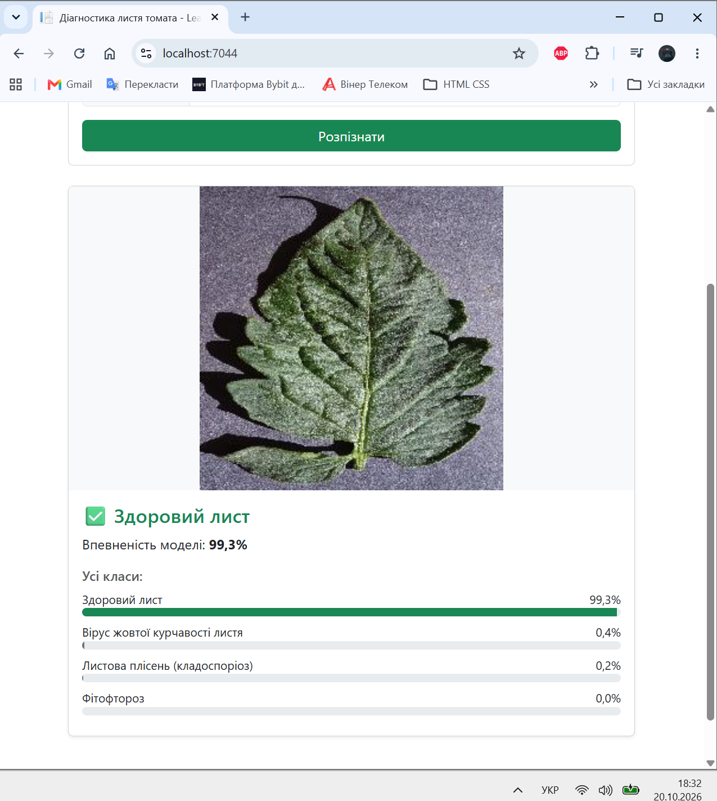
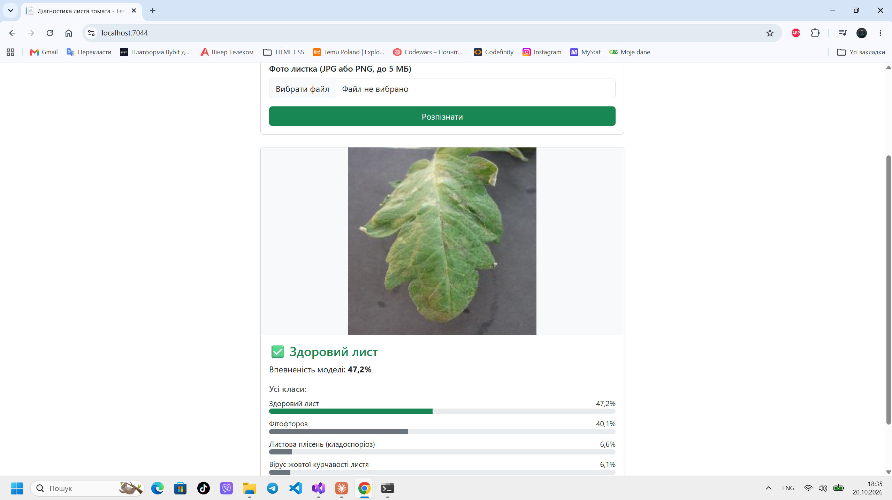

# 🍅 LeafDoctor — розпізнавання хвороб листя томата

Вебсервіс на ASP.NET Core MVC, який за фото листка томата визначає, чи він здоровий,
або розпізнає одну з хвороб. Модель навчена за допомогою AutoML (ML.NET).

**🌐 Сайт:** _посилання на Azure буде тут_



## Датасет
- Джерело: [Tomato Diseases — Kaggle](https://www.kaggle.com/datasets/luisolazo/tomato-diseases)
- 4 класи по 200 зображень:

| Клас | Опис |
|---|---|
| `healthy` | Здоровий лист |
| `late_blight` | Фітофтороз |
| `leaf_mold` | Листова плісень (кладоспоріоз) |
| `yellow_leaf_curl_virus` | Вірус жовтої курчавості листя |

## Навчання моделі
- Інструмент: **ML.NET CLI (AutoML)**, сценарій `image-classification`
- Алгоритм: ImageClassificationMulti (transfer learning, TensorFlow)
- **Точність (MicroAccuracy): 91,55%**



Команда навчання:

```
mlnet image-classification --dataset "LeafDataset" --name LeafModel
```

> Model Builder у Visual Studio 2026 не зміг запустити навчання через несумісність бібліотек,
> тому використано ML.NET CLI — той самий AutoML-рушій, що й у Model Builder.

## Архітектура (MVC)
- `Controllers/HomeController.cs`: приймає фото, валідує, повертає результат
- `Models/`: `PredictionResult`, `PredictViewModel`
- `Services/`: `ILeafClassifier` + `LeafClassifier` (робота з ML-моделлю через DI)
- `Views/Home/Index.cshtml`: форма завантаження та відображення результату
- `LeafModel.mlnet`: навчена модель, `LeafModel.consumption.cs`: код її використання

## Технології
.NET 10 · ASP.NET Core MVC · ML.NET 3.0 · TensorFlow · Bootstrap · Azure App Service

## Запуск локально
1. Відкрити `LeafDoctor.sln` у Visual Studio
2. Запустити (F5)